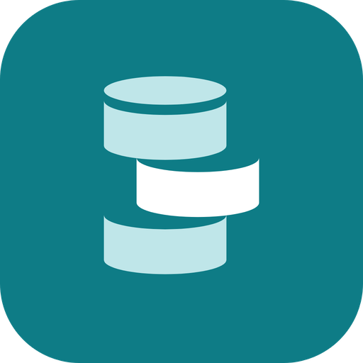
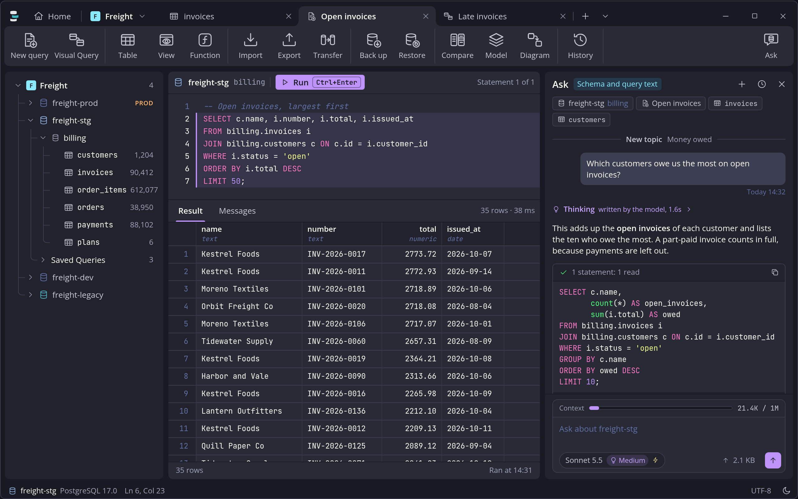
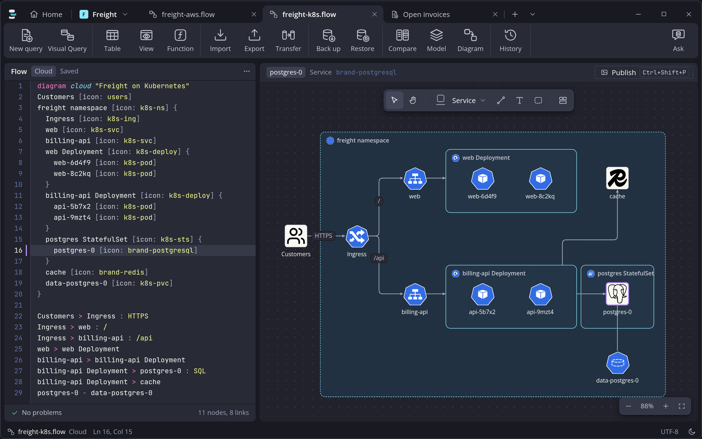
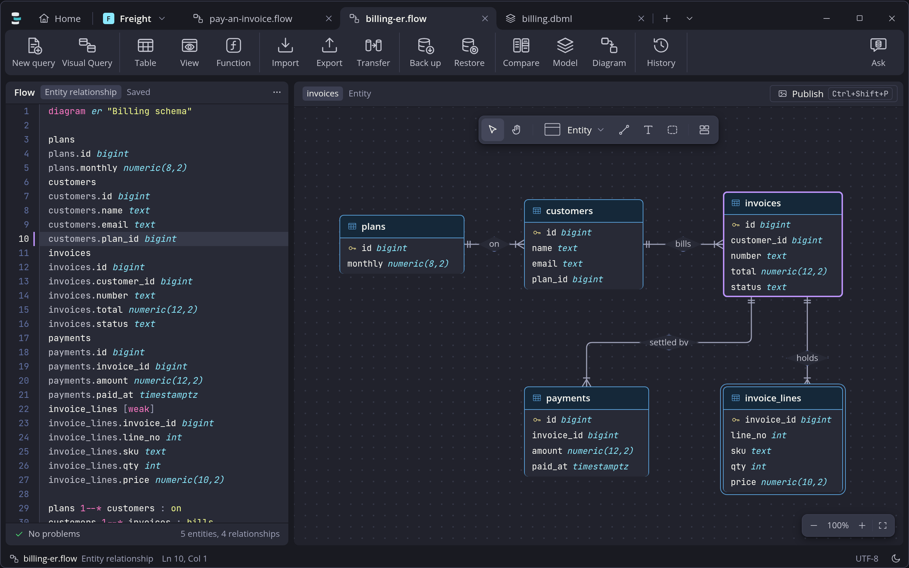
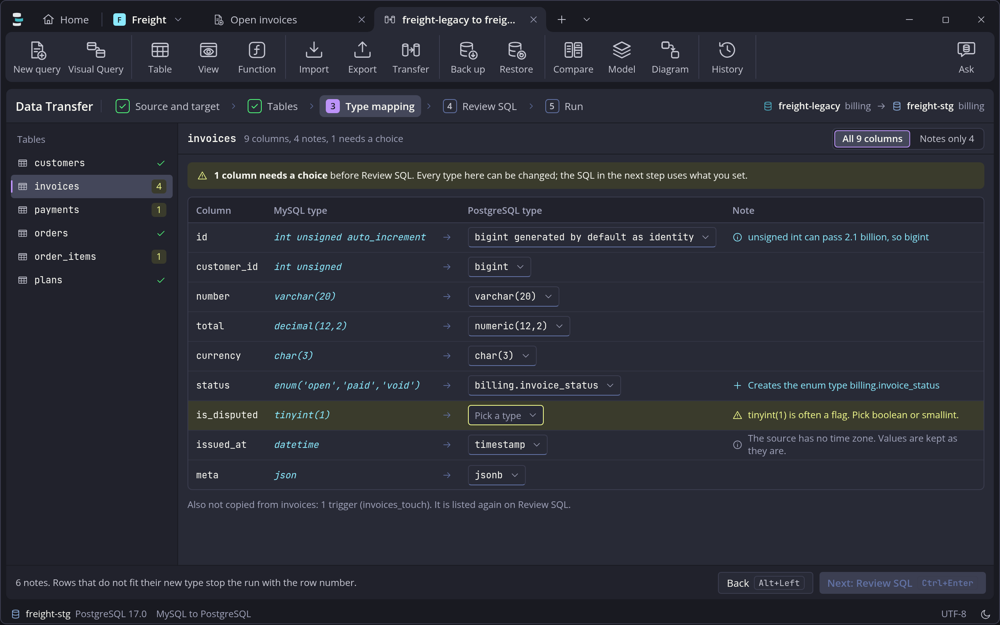
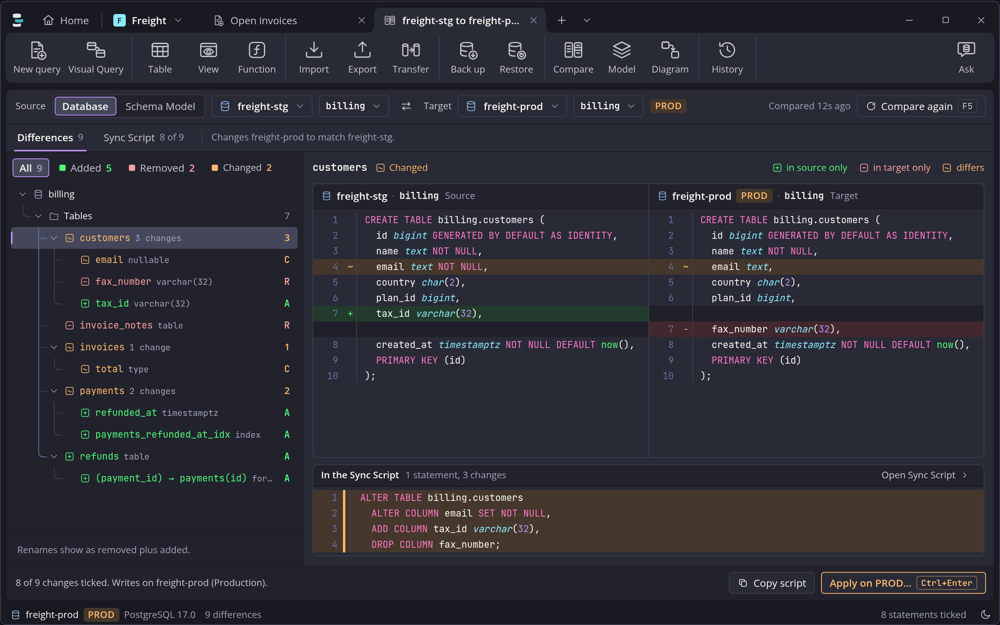
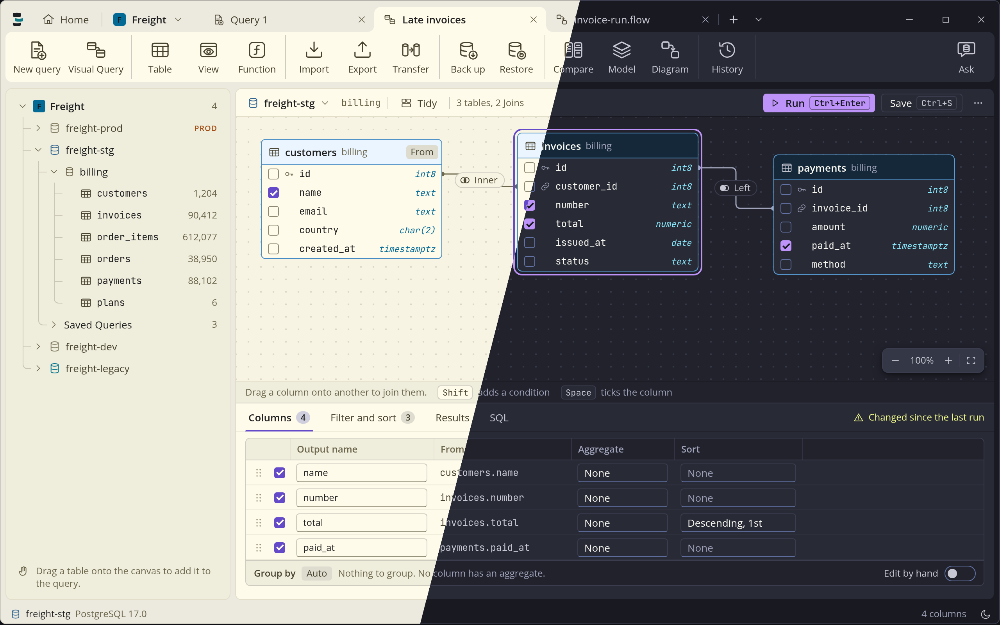

<p align="center">
  
</p>

<h1 align="center">Contura</h1>

<p align="center">
  <b>A fast, light database client for MySQL, PostgreSQL and SQLite,<br>
  with an AI assistant that never runs anything on your database by itself.</b>
</p>

<p align="center">
  <a href="https://github.com/Rifqio/contura/releases/latest"></a>
  <a href="https://github.com/Rifqio/contura/releases"></a>
  <a href="https://github.com/Rifqio/contura/actions/workflows/ci.yml"></a>
  <a href="LICENSE"></a>
  
</p>
<p align="center">
  
  
  
</p>

<p align="center">
  
</p>

---

I built Contura because my everyday database tool felt heavy. It does what I reach for every day (browse tables, write queries, design schemas, move data) in one small app with a Rust core, and it stays out of your way.

## Download

<p align="center">
  <a href="https://github.com/Rifqio/contura/releases/latest"></a>
  &nbsp;
  <a href="https://github.com/Rifqio/contura/releases/latest"></a>
</p>

| | |
|---|---|
| **Windows 10/11** | `Contura_x64_portable.exe`: no installer. Put it in any folder and run it. |
| **Ubuntu / Debian** | `Contura_amd64.deb`: `sudo apt install ./Contura_*.deb` |
| **Other Linux** | `Contura_amd64.AppImage`: `chmod +x` it and run. |

## A quick tour

The screenshot at the top is the everyday view: the Database Tree on the left, a query tab with its result grid in the middle, and the Ask panel on the right, answering with SQL you can read before anything runs. The sections below take one part of Contura at a time.

### Write SQL that knows your database

The SQL editor reads your schema in the background, so completion offers real tables and columns, understands aliases, and can write a whole JOIN from your Foreign Keys. Mistakes are underlined as you type, and a quick fix is one keypress away (Ctrl+.). Results open below the editor, a page of 1,000 rows at a time, and a running query can be cancelled on the server with Esc.

Every statement you run goes into Query History, and the ones you want to keep become Saved Queries.


*Above: typing a query with column and table suggestions open, with the rows of the last run below.*

### Browse and edit data without writing SQL

Open any table and work with it like a spreadsheet. Filter it in words ("status is paid"), sort by any column, edit a cell, add a row or delete one. Nothing is written straight away: changes wait as Pending Edits, highlighted in the grid, until you press Save, and then they are saved together in one transaction. Discard throws them all away.


*Above: `billing.invoices` filtered and sorted by total, with one edited cell, one new row and the Save bar.*

### Build queries by dragging

Visual Query is for queries you would rather see than type. Drag tables from the Database Tree onto the canvas, and Contura joins them for you using their Foreign Keys. Drag one column onto another to add a join of your own, and pick inner, left, right or full. Tick the columns you want, then set filters, grouping, sorting and a limit in the panel below.

The SQL is written for you as you go. Open it in the SQL editor when you want to change it by hand, or save the Visual Query to come back to.


*Above: `customers`, `invoices` and `payments` joined on the canvas, with the Columns tab of the bottom panel open.*

### Design schemas in DBML

The Schema Builder designs a database without running any SQL. Write the schema as [DBML](https://dbml.dbdiagram.io/) on the left and the diagram follows on the right as you type. It works the other way too: add a table, rename a column or drag one column onto another to make a Foreign Key on the canvas, and only the lines it changes are rewritten in the text.

Start from a blank model, an existing `.dbml` file, or reverse engineer a database you already have. When the model is ready, export it as a SQL script or as an image, or apply it to a Connection: Contura compares the two and writes a Sync Script for you to review before it runs.


*Above: the `billing` schema written as DBML on the left and drawn as table cards on the right.*

### Draw diagrams from text

Diagrams work the same way as the Schema Builder: you write a short text file (a `.flow` file) and Contura draws it, and changes on the canvas go back into the text. There are nine kinds: data flow, flowchart, cloud architecture, entity relationship, sequence, state, class, mind map and timeline. Each one can be published as a PNG or SVG, and a Mermaid flowchart can be imported.

Cloud diagrams use a built-in icon pack with AWS, Azure, Google Cloud and Kubernetes icons, so an architecture drawing looks like the real thing.

On a diagram, the Ask panel can draw for you too: describe what you want ("add a Redis cache between the API and the database") and the assistant proposes the changes. You review them one by one before they land, and one Ctrl+Z undoes the whole set. The diagram assistant only ever edits the diagram's text; it never touches a database.

Here are four of the kinds:

**Cloud architecture.** The freight app on AWS. The `.flow` text is on the left and the drawing on the right. Customers look the site up through Route 53 and reach it through CloudFront, which also serves invoice PDFs from S3. Inside the VPC, a load balancer in the public subnet sends requests to `billing-api` and `shipping-api` in the private subnet, and they use the billing database (RDS) and the session cache (ElastiCache) in the data subnet. Each `{ }` block in the text becomes a box on the canvas, and `[icon: aws-rds]` picks the icon.


**Kubernetes.** The same app in a `freight` namespace. Customers come in over HTTPS through the Ingress, which sends `/` to the `web` service and `/api` to the `billing-api` service. Each service sits in front of a Deployment with two pods. The API talks SQL to PostgreSQL running as a StatefulSet with its own volume claim, and uses Redis as a cache. Kubernetes icons and brand logos come from the same icon pack.



**Sequence.** Paying an invoice, one message at a time. The customer pays in the web app, which calls the Billing API. The API locks the invoice row in the database, charges the card provider and, only if the charge succeeded (the `opt` block), inserts the payment. Then it answers `201 Created` and the customer gets a receipt. Time runs from top to bottom: solid arrows are calls, dashed arrows are replies, and the bar on the Billing API shows while it is busy.


**Entity relationship.** The `billing` schema as entities with their columns and types. Each line is a relationship named in words, and the marks at its ends show one-to-many: a plan has many customers, a customer is billed many invoices, and an invoice is settled by many payments and holds many lines. `invoice_lines` is a weak entity, drawn with a double border, because a line cannot exist without its invoice. In the text, `plans 1--* customers : on` is one line of the drawing.



### Ask the AI, keep the control

Bring your own provider: OpenAI-compatible, Anthropic, Groq, DeepSeek, or a local model with Ollama or LM Studio. Contura has no AI service of its own, so your key talks to your provider directly.

Each Connection decides what the assistant may see: nothing, the schema, your current query, or sample rows. Every answer lists the steps it took, and a Sends line shows exactly what left your computer for that answer. SQL from the assistant is put into the editor for you to read and run yourself. Nothing runs on its own.


*Above: one question in the Ask panel, with each step it took, the answer with its SQL, and Sends open to show what went out.*

### Move data between databases

Import and export CSV, JSON, Excel and SQL files. Back up a database to a script and restore it later. Data Transfer copies tables from one Connection to another, even from MySQL to PostgreSQL. Before anything is copied, you see how each column type will be mapped on the other side and can change it.



*Above: Data Transfer from `freight-legacy` on MySQL to `freight-stg` on PostgreSQL, on the Type mapping step.*

### Compare two schemas

Schema Compare puts two databases side by side and shows what differs, coloured like Git: green for added, red for removed and amber for changed. Pick an object to see both versions next to each other. From the differences Contura writes a Sync Script. Anything that could lose data starts unticked, and nothing runs until you have read the script and confirmed it.



*Above: comparing `freight-stg` with `freight-prod`, with added, removed and changed objects and labelled panes.*

## Safe by default

- **Production** Connections show you the exact SQL and ask before anything that writes, including what you type yourself.
- **Read-only** Connections block every write, and the database session itself is opened read-only.
- An UPDATE or DELETE without WHERE always asks first.
- Passwords and your AI key live in the system keyring, never in files.


*Above: an UPDATE written by the assistant waits for you to press Run on `freight-prod`, with each statement marked.*

## Your data stays yours

Contura has no account, no cloud and no telemetry. Settings, Connections (without passwords), Query History and Saved Queries live in one data folder. Copy the folder and you have moved everything.

| Version | Data folder |
|---|---|
| Windows portable | `data` next to the exe |
| Linux AppImage | `data` next to the AppImage, when that folder can be written to |
| Linux .deb | `~/.local/share/contura` |

The only thing that ever leaves your computer is what you send to an AI provider you set up yourself.

## Light and dark

Two themes, Dark and Light, switched with one click on the moon at the right end of the status bar. Code and data are set in JetBrains Mono.



## Build from source

You need Node.js 22 and a stable Rust toolchain. On Linux, also the Tauri 2 system libraries (WebKitGTK 4.1, GTK 3).

```sh
npm install
npm run tauri dev          # run it
npx tauri build            # Linux: .deb and AppImage
npx tauri build --no-bundle  # Windows: the portable exe in target/release
npm test                   # front-end tests
cargo test --workspace     # core tests
```

Contura is a Tauri 2 app: a Rust core talks to the databases, and a React front end draws the window.

## Star history

<a href="https://star-history.com/#Rifqio/contura&Date">
  <picture>
    <source media="(prefers-color-scheme: dark)" srcset="https://api.star-history.com/svg?repos=Rifqio/contura&type=Date&theme=dark">
    
  </picture>
</a>

## License

[MIT](LICENSE). Made by [Rifqio](https://github.com/Rifqio).
