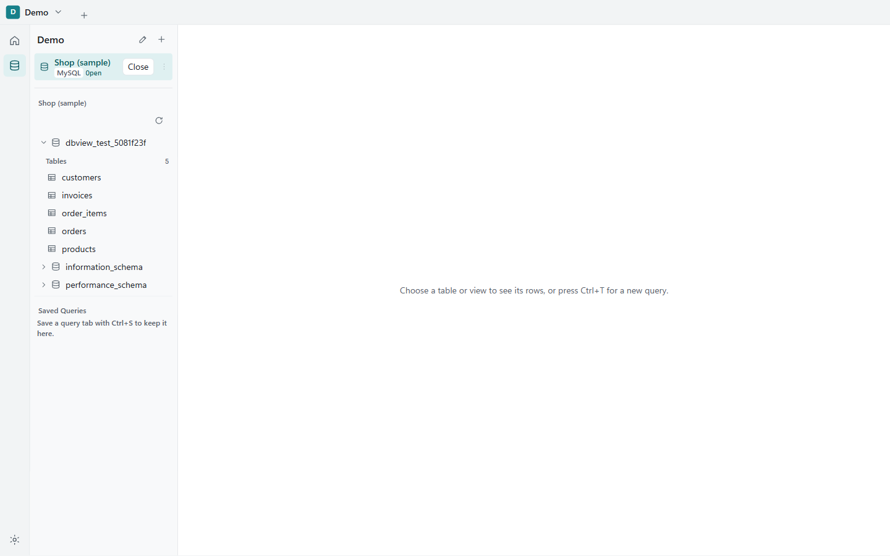

# Contura

Contura is a personal, portable database client for Windows. It connects to MySQL, PostgreSQL and SQLite, and it is meant to feel like Navicat while using less memory. It is one exe that keeps its data beside itself. It was called DB View until 2026-10-16.

## Screenshots



A Group with one open Connection and the tables of its database.


A query tab: SQL on top, the result grid below.


A table opened in the data grid, with column types and the primary key marked.


The Schema Builder after reverse engineering a database: DBML text on the left, the diagram on the right.


The AI assistant panel. No provider is set up here, and the "Sends" line shows what would leave the PC.

## What it does today

- Connections and Groups. A Group holds the Connections for one context of work. Every Connection is in one Group or in Ungrouped.
- Object tree for each Connection: databases, schemas, tables, views and routines.
- Data grid for tables and views, with paging and a WHERE filter.
- SQL editor with completion, inspections, Query History (the last 1,000 statements per Connection) and Saved Queries.
- Schema Builder. Edit a Schema Model as DBML text or on a diagram, and the two stay in step. Reverse engineer an existing database into a Schema Model. Export it as a CREATE script or as an image.
- AI assistant, in the editor and in a side panel. Each Connection has an access level that decides what an Ask may send: nothing, schema only, schema and query text, or those plus sample rows. A "Sends" line shows exactly what would leave the PC before you ask.
- Passwords are kept in Windows Credential Manager, not in files.

## How it works

The Core is written in Rust and talks to the databases. The window is Tauri 2 with a React front end. Contura is a single exe with no installer. Its settings, Groups, Connections (without passwords), Query History and Saved Queries live in a `data` folder next to the exe, so you can copy the folder to move them.

Nothing leaves the PC except what you send to an AI provider that you set up yourself.

## What's next

- Production and Read-only Connections (in progress)
- Pending Edits in the data grid
- Table Designer
- Visual Query
- More diagram types

## Build from source

You need Node.js and a Rust toolchain on Windows.

```
npm install
npm run tauri dev
```

To build the exe without an installer:

```
npx tauri build --no-bundle
```

The exe is written to `target\release\contura.exe`.

To run the front end tests: `npm test`.

## License

Personal project; no license yet.
