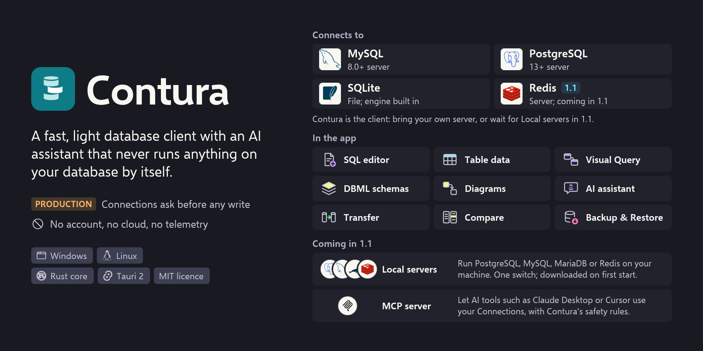
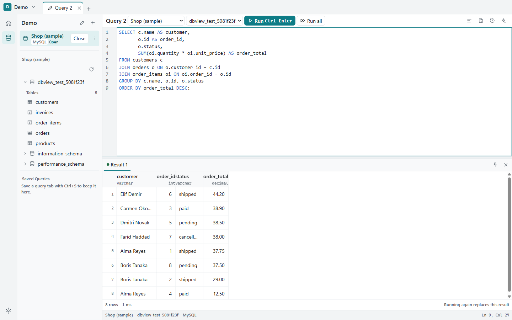
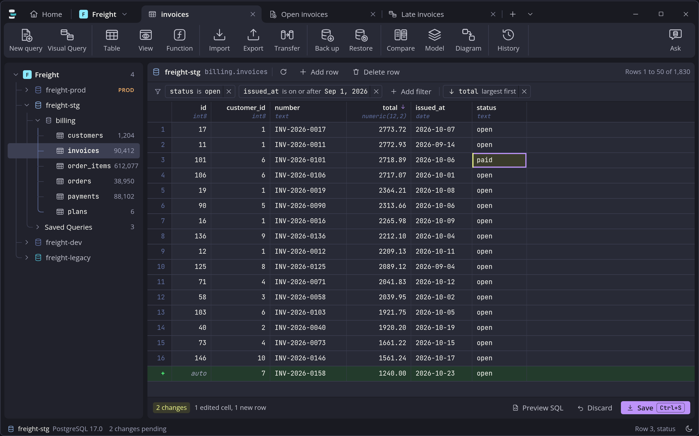
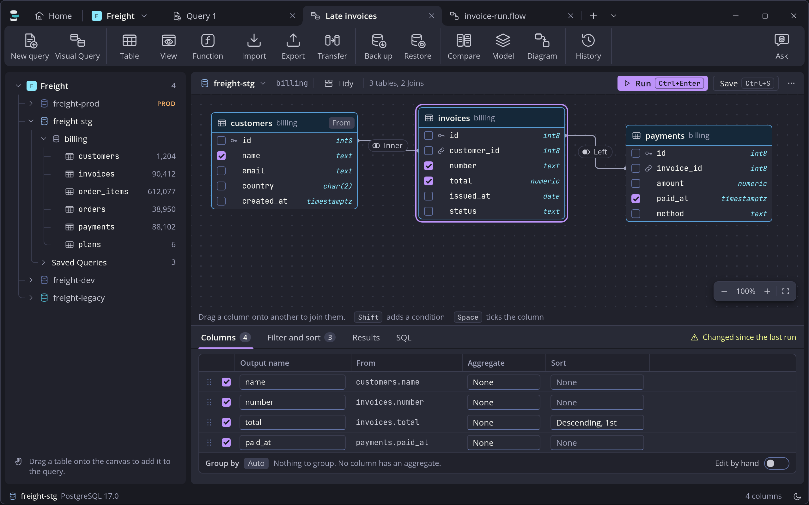
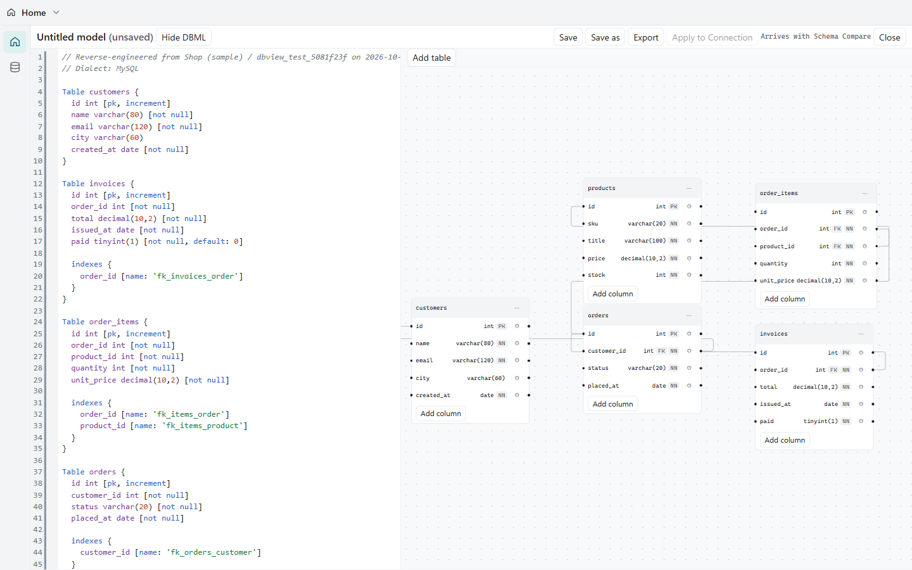
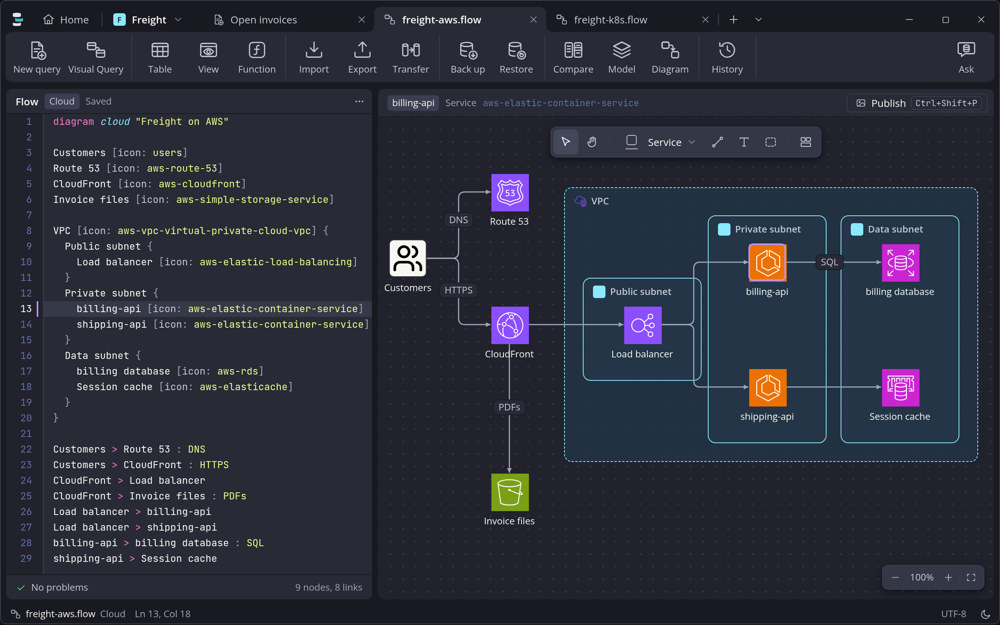
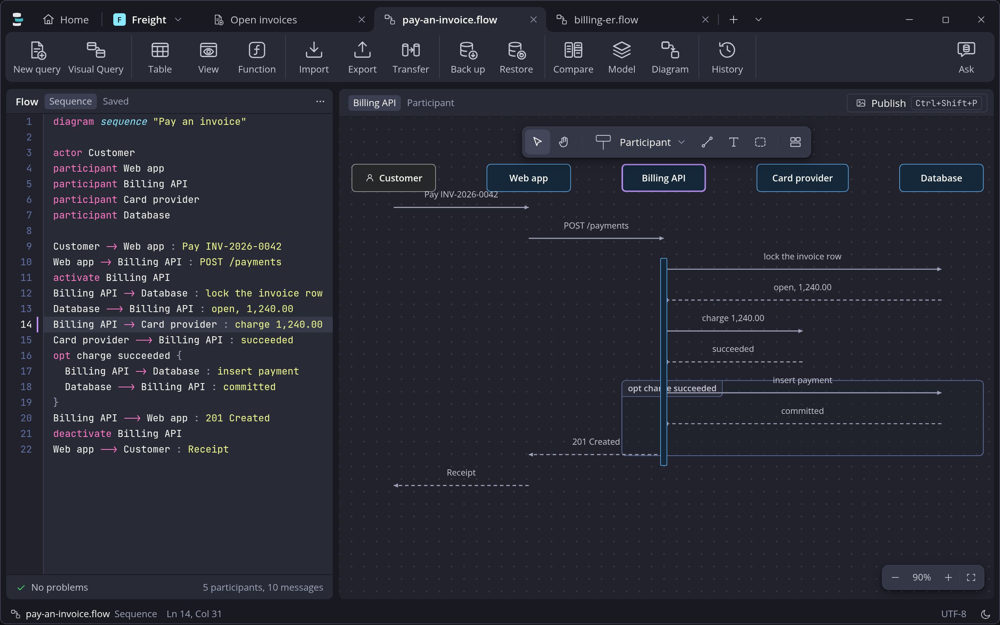
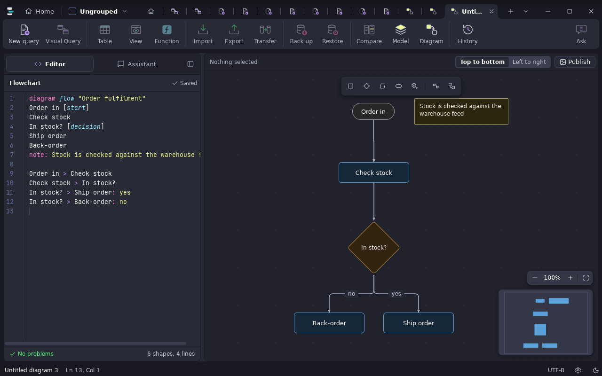
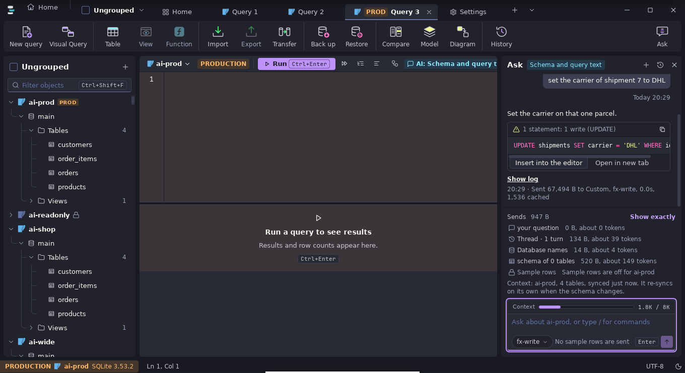
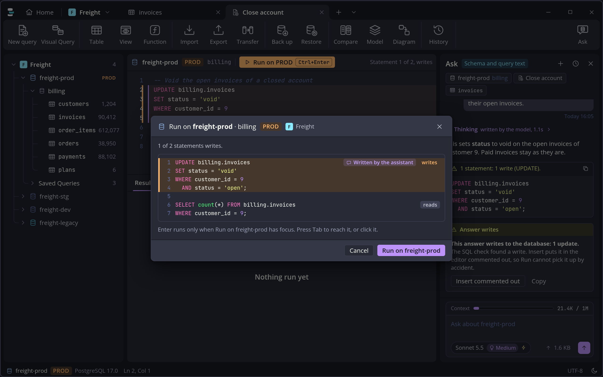

<h1 align="center">Contura</h1>

<p align="center">
  <a href="https://github.com/Rifqio/contura/releases/latest"></a>
  <a href="https://github.com/Rifqio/contura/releases"></a>
  <a href="https://github.com/Rifqio/contura/actions/workflows/checks.yml"></a>
  <a href="LICENSE"></a>
  
</p>

<p align="center">
  <picture>
    <source media="(prefers-color-scheme: light)" srcset="docs/banner-light.png">
    
  </picture>
</p>

https://github.com/user-attachments/assets/76da62f5-007a-44d4-b823-575ae181bd7f

Contura is a small database client for MySQL, PostgreSQL and SQLite, with an AI assistant that writes SQL for you to read. It never runs anything on its own.

No account, no cloud, no telemetry.

## Download

<p align="center">
  <a href="https://github.com/Rifqio/contura/releases/latest"></a>
  &nbsp;
  <a href="https://github.com/Rifqio/contura/releases/latest"></a>
</p>

| | |
|---|---|
| **Windows 10/11** | `Contura_x64_portable.exe`, no installer |
| **Ubuntu / Debian** | `Contura_amd64.deb` |
| **Other Linux** | `Contura_amd64.AppImage` |

The builds aren't code-signed yet. If Windows SmartScreen warns you, choose More info, then Run anyway.

**Databases:** MySQL 8.0+, PostgreSQL 13+ and SQLite (built in).

## What it does

**SQL editor.** Completion from your real schema, JOINs from your Foreign Keys, and errors underlined as you type.



**Table data.** Filter, sort and edit like a spreadsheet. Changes wait until you press Save, then go in one transaction.



**Visual Query.** Drag tables in, tick columns, and read the SQL it writes.



**Schemas and diagrams.** Design schemas in DBML. Draw ER, flowchart, sequence, state, class and cloud diagrams side by side on one board.

| | |
|---|---|
|  |  |
|  |  |

**AI assistant.** Bring your own provider: Anthropic, OpenAI-compatible, Groq, DeepSeek or a local model. Each Connection decides what it may see, and every answer keeps a full log of what was sent.



**Move data.** Import, export, backup, restore, Data Transfer between databases, and Schema Compare.

## Safe by default

- **Production** Connections show the exact SQL and ask before any write.
- **Read-only** Connections block every write.
- An UPDATE or DELETE without WHERE always asks first.
- Passwords and AI keys stay in the system keyring.



## Coming in 1.1

Redis, local database servers you start with one switch, and an MCP server.

## Build from source

You need Node.js 22 and a stable Rust toolchain. On Linux, also the Tauri 2 system libraries (WebKitGTK 4.1, GTK 3).

```sh
npm install
npm run tauri dev            # run it
npx tauri build              # Linux: .deb and AppImage
npx tauri build --no-bundle  # Windows: the portable exe in target/release
npm test                     # front-end tests
cargo test --workspace       # core tests
```

Contura is a Tauri 2 app: a Rust core talks to the databases, and a React front end draws the window.

## Star history

<a href="https://star-history.com/#Rifqio/contura&Date">
  <picture>
    <source media="(prefers-color-scheme: dark)" srcset="https://api.star-history.com/svg?repos=Rifqio/contura&type=Date&theme=dark">
    
  </picture>
</a>

## License

[MIT](LICENSE). Made by [Rifqio](https://github.com/Rifqio). If Contura helps you, a star tells me it was worth sharing.
